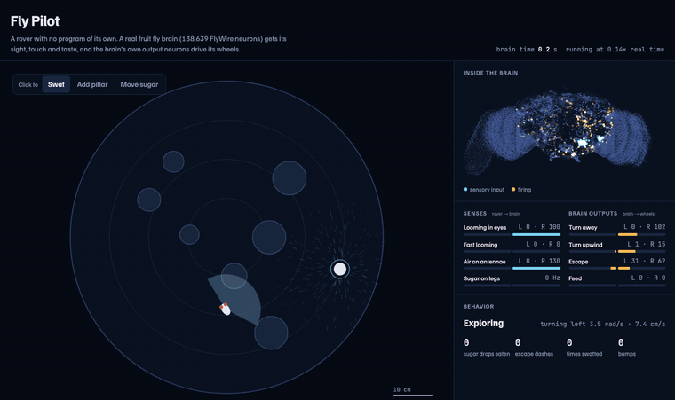

# Fly Pilot

A rover with no driving program of its own. Its "brain" is the complete adult fruit fly
connectome from [FlyWire](https://flywire.ai) (v783: 138,639 neurons, 15 million connections),
simulated as leaky integrate-and-fire neurons following
[Shiu et al., *Nature* 2024](https://github.com/philshiu/Drosophila_brain_model).

**[Try it live](https://rreddy80.github.io/fly-pilot/)** (31 MB download, best on a laptop)



*30 s of fly brain time, shown at real fly speed. In the browser it runs at about 0.3–1× that.*

```
./start.sh          # opens http://localhost:8765
```

## How the loop works

Every 5 ms of brain time:

1. **Senses → sensory neurons** (`world.js`, `sense`)
   - Objects growing in the left or right visual field drive that eye's **LC4** looming
     detectors, and fast looming also drives **LPLC2**.
   - A fan behind the sugar blows air outward. Air hitting the left or right antenna drives
     that side's **Johnston's organ** wind/gravity neurons.
   - Standing on the sugar drives the **sugar taste neurons**.
2. **The brain runs** (`sim.js`). Nothing about the task is programmed into it.
3. **Descending neurons → wheels** (`world.js`, `decode`). The rover reads these neurons:
   - **Turn away**: DNp04, DNp02, DNp11, DNp05, DNp03. LC4 drives them on the same side,
     so the rover turns toward the quieter side.
   - **Turn upwind**: DNge091, DNb06, DNp18, DNpe017, DNg07, DNbe001. Wind drives them on
     the same side, so the rover turns toward the louder side.
   - **Escape**: the giant fiber, DNp01. A strong burst triggers an escape dash.
   - **Feed**: MN9 and MN10. While they fire on sugar, the rover stops and eats. The body slows
     to 30% while its legs touch sugar (`contactSlow`), so a glancing pass lasts long enough
     for MN9 to fire. Whether it stops is still up to the brain.

The decoder itself is hand-written: it decides that "left upwind neurons firing more" means
"turn left". What the brain contributes is the mapping from senses to those neurons. I measured
which descending neurons respond to each sense, and on which side, using the probes in `tools/`.
The rover also adds a little random wander of its own.

## Things to try

- Knock out the **giant fiber** and watch the swats land.
- Knock out the **wind-steering neurons**. The rover still feels the air but no longer
  finds the sugar.
- Knock out **MN9/MN10**. It walks right over the sugar.
- Swat it yourself, add pillars, or move the sugar.

## Known limits

- Smell is left out on purpose. Driving the olfactory receptor neurons, even weakly, starts
  self-sustaining activity across ~10,000 neurons in this model. That freezes the loop, so
  the sugar is found by its airflow instead.
- The wind neurons fire a little more on the right for equal input. The decoder subtracts
  that measured 3.5 Hz bias (`upwindBias`).
- The brain runs at roughly 0.3–1× real time on a laptop, and the arena clock follows the
  brain clock.

## Files

| file | what |
|---|---|
| `sim.js` | connectome decoder and event-driven LIF simulator |
| `world.js` | arena, sensor encoders, motor decoder (all tuning in `P`) |
| `brain-worker.js` | runs the closed loop in a Web Worker |
| `app.js`, `index.html`, `style.css` | the view |
| `tools/headless.js` | runs the loop in Node and prints what the rover did: `node tools/headless.js 40` |
| `tools/prep_data.py` | rebuilds `data/` from the FlyWire / Shiu et al. source files |

Data: FlyWire connectome (Dorkenwald et al. 2024; Schlegel et al. 2024, *Nature*);
connectivity table and model parameters from Shiu et al. 2024.

## Credits and license

- **Connectome:** the [FlyWire Consortium](https://flywire.ai), led by Princeton University,
  proofread by a large community of researchers and citizen scientists. The neuron
  reconstruction started from Google Research's automated segmentation of the FAFB electron
  microscopy volume, which was imaged at HHMI Janelia (Zheng et al. 2018, *Cell*).
- **Brain model:** Shiu et al. 2024, [Drosophila_brain_model](https://github.com/philshiu/Drosophila_brain_model) (MIT).
- **Code** in this repository: MIT, see [LICENSE](LICENSE) and [NOTICE.md](NOTICE.md).
- **Data** in `data/`: derived from FlyWire v783 and licensed under
  [CC BY-NC 4.0](https://creativecommons.org/licenses/by-nc/4.0/). **Non-commercial use only.**
  See [data/LICENSE.md](data/LICENSE.md) for sources and the changes made.

This is an independent project, not affiliated with or endorsed by FlyWire, Princeton, Google,
HHMI Janelia or the authors above.
